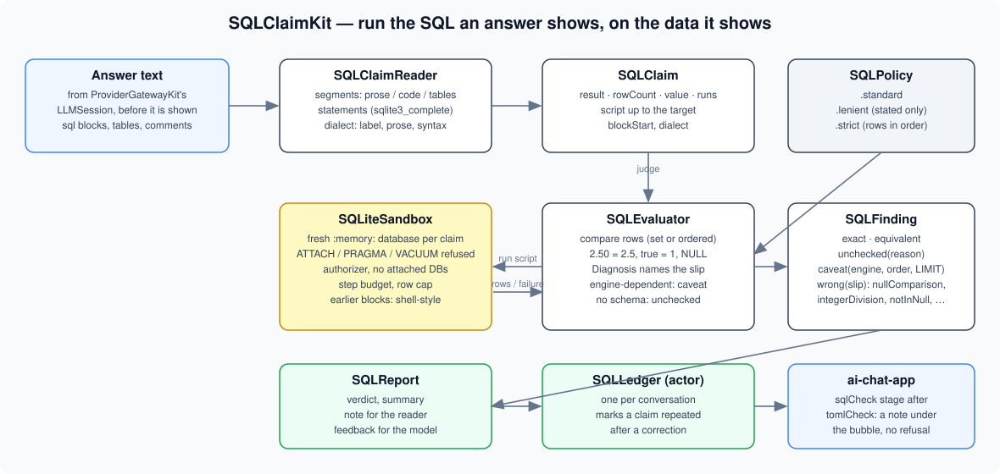
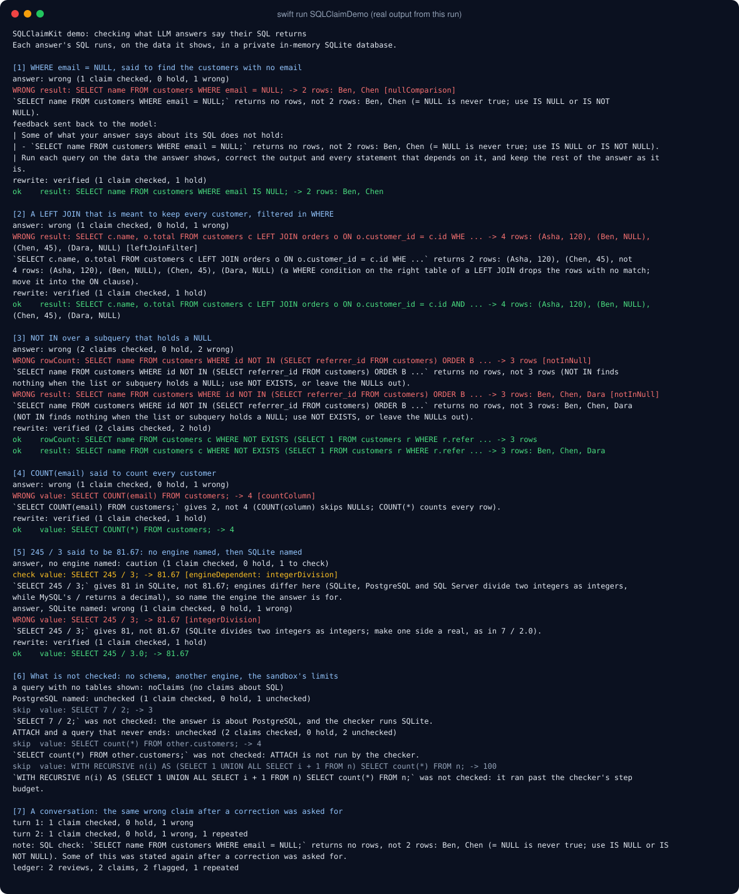
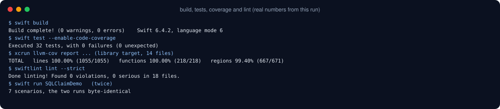

# SQLClaimKit



Ask a model for the customers with no email and it writes `WHERE email = NULL`, then shows a table with Ben and
Chen in it. The query returns no rows: `= NULL` is never true. Ask for every customer with their paid orders and
it filters the `LEFT JOIN` in `WHERE`, which drops the customers with no order, and still shows all four. Ask
for the customers who never referred anyone and it uses `NOT IN` over a column that holds a NULL, which finds
nothing, and shows three names. Ask for an average and it writes `SELECT 245 / 3;  -- 81.67`; SQLite gives 81.

Each of those answers shows its own data and its own output, so each can be checked by running it. SQLClaimKit
reads what an answer says its SQL returns (a table of output, "this returns 3 rows", a value in a comment after
a query, "this runs" or "this fails") and runs the answer's SQL, on the tables and rows the answer creates, in a
private in-memory SQLite database. It says which claims hold, which need a second look because engines differ,
and which are wrong, with what SQLite really returns and, where it can tell, the mistake behind it.

## Why

The series' claim checkers rerun what an answer works out on its own: dates, arithmetic, units, regexes,
strings, JSON, YAML and TOML. SQL is the code answers show most often with its output written next to it, and
the usual mistakes do not fail loudly: the query runs and returns something plausible. Studies of generated SQL
make the same point (a run that succeeds is not a result that is right), and most of the classic slips are about
NULL: `= NULL`, `COUNT(column)`, `NOT IN` with a NULL in the list, a `LEFT JOIN` undone by `WHERE`.

What this package checks is narrower than "is this the right query". It checks the output an answer states
against the data the same answer shows. Whether the query fits the question asked is a different problem, and
this package does not judge it.

## What it checks

| Claim | Where it comes from | Checked by |
|---|---|---|
| **result** | a markdown table, a psql-style box, or `sqlite3` list output right after a SQL block (one short line of prose may sit between them: "This returns:") | running the block's last query and comparing the rows |
| **rowCount** | "returns 3 rows.", "gives no rows,", "(2 rows)" right after the block, or in a comment after a query; the count must end the phrase, so "one row per customer" and "2 rows for each team" are not counts | counting the rows |
| **value** | a comment after a query made of literals only: `-- 3.5`, `-- 'Ann'`, `-- NULL`, `-- 1 \| 'x'`, optionally after `returns`, `result:`, `=>`, `→`; a comment in words (`-- returns the active users`, `-- ===== orders =====`) is not a value | running that statement |
| **runs** | "This is valid SQL:", "this runs as is", "this fails with an error" next to a block; and, under `.standard`, every block with no other claim | running the block |

The script for a claim is every SQL block up to and including the one it is about, so the schema shown first is
there when the query runs. Earlier blocks run the way the `sqlite3` shell runs a file: a statement that fails is
reported there and the next one still runs. Statements are split where `sqlite3_complete` agrees one ends, so a
trigger's `BEGIN ... END` stays whole.

Rows are compared as a set unless the query has a top-level `ORDER BY` (or the policy is `.strict`). A cell
holds when it means the value: quotes around text, `NULL` written as `null`, `2.50` for 2.5, `0.67` for 0.6666…
(rounded to the decimals shown), `true` or `t` for 1.

### No schema, no claim

Most SQL in chat queries tables the answer never creates. That SQL is not judged: a stated result is reported
as unchecked ("the answer does not create the table people"), and a block with no claim about it is dropped
altogether. A block with no claim is kept only when SQLite settles it, running or failing.

### The engine

| The answer says | What happens |
|---|---|
| SQLite (a `sqlite` label, or the word in the prose) | SQLite's result settles every claim |
| nothing | SQLite runs it; where engines differ (below), a mismatch is a caveat, not a mistake |
| PostgreSQL, MySQL, SQL Server, Oracle, or another engine (by label, by name, or by syntax only it has: `SERIAL`, `::`, `ILIKE`, `AUTO_INCREMENT`, `TOP n`) | not checked in 1.0.0 |

The differences treated as engine-dependent: `/` on two integers (SQLite, PostgreSQL and SQL Server truncate;
MySQL returns a decimal), where NULLs sort (first in ascending order in SQLite and MySQL, last in PostgreSQL and
Oracle), whether `LIKE` ignores case (it does in SQLite and with MySQL's default collations, not in PostgreSQL),
and `||` (string concatenation in SQLite and PostgreSQL, OR in MySQL by default). SQL that SQLite cannot parse
is a caveat when no engine is named ("if it is meant for another engine, name it").

### The slips it names

| Slip | What happened |
|---|---|
| `nullComparison` | `= NULL` or `<> NULL`, which is never true; use `IS NULL` |
| `integerDivision` | two integers divided as integers (`245 / 3` is 81) |
| `countColumn` | `COUNT(column)` taken to count the rows where the column is NULL |
| `notInNull` | `NOT IN` over a list or subquery that holds a NULL, which finds nothing |
| `leftJoinFilter` | a `WHERE` condition on the right table of a `LEFT JOIN`, which drops the rows with no match |
| `nullOrdering` | NULLs placed last in an ascending sort |
| `likeCase` | `LIKE` taken to be case-sensitive |
| `betweenInclusive` | `BETWEEN` taken to leave out its ends |
| `concatOperator` | `\|\|` and what it means on another engine |
| `missingColumn`, `constraint`, `syntax`, `raises` | the SQL raises an error where the answer shows a result |
| `columnCount` | the output shown has a different number of columns than the query returns |
| `runs` | the SQL said to fail runs |

Four caveats besides the engine: rows in another order where `ORDER BY` columns may tie (`rowOrder`), different
rows from a `LIMIT` with no `ORDER BY` (`unorderedLimit`), SQL SQLite cannot parse with no engine named
(`otherSyntax`), and text written in double quotes (`WHERE name = "Ann"`) that this SQLite reads as a missing
column (`doubleQuotedText`; builds that fall back to reading it as text, such as macOS's, run it and do not flag it).

## The sandbox

This package runs model-written SQL, so the database it runs in is shut in:

- a fresh `:memory:` database for every claim, closed when the claim is judged;
- `ATTACH`, `DETACH`, `PRAGMA` and `VACUUM` refused before they are prepared, an authorizer that refuses
  attaching, detaching, pragmas and `load_extension`, and `SQLITE_LIMIT_ATTACHED` set to 0;
- a step budget (a progress handler) and a row cap, so a recursive CTE that never ends comes back unchecked.

The tests check that `ATTACH` and `VACUUM INTO` leave no file behind. A mutation check removed the `VACUUM`
keyword refusal: the authorizer still refused `VACUUM INTO` on its own.

## Install

```swift
.package(url: "https://github.com/rajatslakhina/sql-claim-kit.git", from: "1.0.0")
```

and `.product(name: "SQLClaimKit", package: "sql-claim-kit")` in your target. Swift 6, no dependencies beyond
the system SQLite: Apple's `SQLite3` module on macOS 13, iOS 16, tvOS 16 and watchOS 9, and `libsqlite3` on
Linux (install the headers first: `apt-get install libsqlite3-dev`, or `sqlite-devel` on Fedora/RHEL).

## Usage

```swift
import SQLClaimKit

let report = SQLClaimChecker().check(answer)
switch report.verdict {
case .noClaims, .verified: break
case .unchecked, .caution, .wrong:
    showNote(report.note)              // "SQL check: `SELECT name FROM customers WHERE email = NULL;` returns no rows, …"
    nextTurnFeedback = report.feedback // a message asking the model to redo what it got wrong
}
```

Across a conversation, a `SQLLedger` (an actor) marks a claim that was flagged before as repeated:

```swift
let ledger = SQLLedger()
let report = await ledger.review(answer)
report.repeatedCount   // flagged claims already flagged earlier in the conversation
```

### Policies

| Policy | Blocks with no claim | Caveats | Row order |
|---|---|---|---|
| `.standard` | checked (kept when SQLite settles them) | reported | as a set unless the query orders it |
| `.lenient` | not checked | reported as unchecked | as a set unless the query orders it |
| `.strict` | checked | reported | as shown |

## How it fits

- **ProviderGatewayKit** sends the turn; this package checks the answer that comes back. It has no compile-time
  dependency on it: run it on the reply text before the answer is shown.
- **TOMLClaimKit**, **YAMLClaimKit** and **JSONClaimKit** check config formats; this one checks the SQL answers show.
- **OutputRepairKit** runs a bounded repair loop; `report.feedback` is the re-prompt.
- **ai-chat-app** runs it as the `sqlCheck` stage after the model answers.

## Demo



`swift run SQLClaimDemo` runs seven scenarios, each answer followed by the rewrite its feedback asks for:
`WHERE email = NULL`, a `LEFT JOIN` filtered in `WHERE`, `NOT IN` over a column with a NULL, `COUNT(email)` said
to count every customer, `245 / 3` said to be 81.67 (a caveat with no engine named, wrong once SQLite is named),
what is not checked (a query with no tables shown, PostgreSQL named, `ATTACH` and a query that never ends), and a
conversation through a `SQLLedger` where the same wrong claim comes back. The full output is in
[Screenshots/demo-output.txt](Screenshots/demo-output.txt); two runs are byte-identical.

## Quality



- `swift build`: 0 warnings, 0 errors (Swift 6.4.2, language mode 6).
- `swift test --enable-code-coverage`: 34 tests, 0 failures. The same 34 pass on the iOS 27.2 simulator
  (`xcodebuild test -scheme SQLClaimKit-Package`), whose SQLite is the one the app runs.
- `llvm-cov report` on the library: **100.00% of lines (1066) and functions (218)** in all 14 files; regions
  99.26% (673/678). The missed regions are short-circuit arms in the wording and the value matcher;
  [Screenshots/coverage.txt](Screenshots/coverage.txt) has the full report.
- `swiftlint lint --strict`: 0 violations in 18 files, with the series' `.swiftlint.yml` unchanged. One
  `optional_data_string_conversion` is disabled on one line, with the reason beside it (SQLite hands TEXT back as
  UTF-8; a failable initializer would add a branch no value reaches).
- Mutation checks, each mutant failing the suite (judged by exit status): earlier blocks no longer passed over
  shell-style, the `VACUUM` keyword refusal removed, and the `= NULL` diagnosis disabled.
- Linux (1.1.1): `swift build` 0 warnings and the same 34 tests pass in the `swift:6.0` Docker image (Swift
  6.0.3, Ubuntu 24.04, SQLite 3.45.1 from `libsqlite3-dev`); `swift run SQLClaimDemo` prints the same output as on
  the Mac.
- Results come from the system SQLite (3.54.0 on the Mac this was built on). Error messages are SQLite's own and
  can change between SQLite versions.

## Changes

- **1.1.1** (2026-11-12): builds on Linux. 1.1.0 imported `SQLite3`, a module only Apple platforms have, so
  `swift build` on Linux stopped at `no such module 'SQLite3'`. A `CSQLite` system-library target now links
  `libsqlite3` on Linux only; Apple platforms still import `SQLite3`, so nothing changes there (same tests,
  coverage and demo output).
- **1.1.0** (2026-11-11): a comment after a query is a value only when it is made of literals (1.0.0 also read
  words after `returns`, so `-- returns the active users` was "wrong"); a row count must end its phrase (1.0.0 read
  "one row per customer" as a count of 1); new caveat `doubleQuotedText`. Found by probing 1.0.0 with prose that
  is not a claim, the same day it shipped. New public enum case, so a minor version.
- **1.0.0** (2026-11-11): first release.

## Limits

- One engine runs: SQLite. Answers for PostgreSQL, MySQL, SQL Server or Oracle are not checked in 1.0.0.
- Column names in a shown table are not compared, only the number of columns and the values.
- Sentences about SQL in general ("`COUNT(col)` counts NULLs") are not read; only output stated for SQL the
  answer shows.
- A slip is named from the query's shape and the two results; a mismatch with no recognisable shape is wrong with
  no slip.
- Ties in `ORDER BY` are not detected; rows in another order under `ORDER BY` are a caveat, or `nullOrdering`
  when a NULL is what moved.
- Foreign keys are not enforced (SQLite's default), so an answer that relies on a foreign key error is not
  confirmed.

## Part of a series

One of a set of Swift packages around
[ProviderGatewayKit](https://github.com/rajatslakhina/foundation-model-provider-gateway); the
[umbrella demo](https://github.com/rajatslakhina/llm-ecosystem-demo) runs them together and
[ai-chat-app](https://github.com/rajatslakhina/ai-chat-app) uses them in a real send pipeline.

MIT license.
